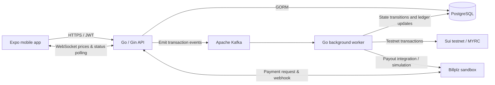

# Swap N Go

**An event-driven blockchain e-wallet built as a Software Engineering Final Year Project.**

Swap N Go combines a **React Native / Expo mobile app**, **Go (Gin) API**, **Kafka background workers**, **PostgreSQL**, and **Sui testnet** integration to explore a MYR-pegged stablecoin (**MYRC**) payment experience. Developed with **Claude Code as an AI coding assistant**, alongside human architecture decisions, implementation review, and testing.

> **Academic prototype, not a regulated payment service.** Blockchain interactions use testnet configuration; parts of the multi-asset experience use a simulated off-chain ledger. Do not use real money, production credentials, or sensitive customer data with this project.

## What it demonstrates

- **Full-stack delivery:** Expo mobile UI, authenticated Go APIs, PostgreSQL persistence, and Docker-based services.
- **Asynchronous financial workflows:** API-initiated deposits, withdrawals, transfers, and swaps processed by Kafka consumers.
- **Explicit transaction lifecycles:** finite-state machines (FSMs) validate allowed changes to operation status.
- **Blockchain and fiat integration:** Sui testnet MYRC operations and Billplz sandbox payment callbacks.
- **Real-time client updates:** WebSocket price delivery and client-side operation-status polling.
- **Performance-oriented design:** benchmarked Kafka partitioning and duplicate-settlement behavior.

### Final-year-project benchmark

| Metric | Recorded result |
| --- | ---: |
| Baseline throughput | **16.7 transactions/second** |
| Optimized throughput | **78.4 transactions/second** |
| Improvement | **4.69×** |
| Experiment configuration | **8 Kafka partitions** |
| Duplicate settlements during reported test | **0** |

These figures are **FYP benchmark results**, not verified production throughput or availability guarantees. The checked-in local Docker Compose setup creates topics with **one partition** by default; reproduce the eight-partition experiment configuration before comparing results.

## System architecture



**Typical async workflow**

1. The mobile client submits an authenticated transaction request.
2. The API validates the request, creates a pending record, and publishes an event.
3. A Kafka worker consumes the event, applies the operation's state machine, and executes the required processing.
4. PostgreSQL stores balances, transaction records, and lifecycle state.
5. The mobile client polls for a terminal status; the backend also provides a price WebSocket feed.

The **Go API** and **Kafka worker** are separate processes sharing the same domain/business logic. Some tokens (BTC, ETH, USDT and USDC) have **simulated off-chain balances**, rather than real multi-chain settlement.

## Features

| Area | Implementation |
| --- | --- |
| Accounts | Registration/login, JWT authentication, custodial wallet records, PIN/KYC-related flows |
| Wallet | Multi-token balance display, portfolio valuation and wallet address views |
| Deposit | MYR deposit initiation, Billplz callback processing and MYRC minting flow |
| Transfer | Send to a supported recipient, with async transaction tracking |
| Swap | Token conversion requests, Kafka execution and state tracking |
| Withdrawal | Withdrawal initiation with blockchain/payment workflow integration |
| Prices | Live price WebSocket and mobile UI updates |
| Mobile UX | Authentication screens, balance dashboard, QR scan/display, transaction history and status pages |

See the code and supporting specifications for endpoint-level behavior. A documented feature or route should not be interpreted as proof of successful external integration in every environment.

## Repository structure

```text
Swap-N-Go/
├── backend/                    # Go API, Kafka worker and infrastructure
│   ├── cmd/api/                # Gin API entry point
│   ├── cmd/worker/             # Kafka consumer entry point
│   ├── internal/
│   │   ├── handlers/           # HTTP request handling
│   │   ├── bizs/               # Business orchestration
│   │   ├── services/           # Domain services
│   │   ├── repositories/       # Persistence via GORM
│   │   ├── fsm/                # Transaction state machines
│   │   ├── kafka/              # Event producers/consumers
│   │   └── clients/            # Sui, Billplz and other integrations
│   ├── pkg/
│   ├── tests/
│   ├── docs/
│   ├── docker-compose.yml
│   ├── docker-compose.prod.yml
│   └── DEPLOY.md
├── mobile/                     # Expo / React Native app
│   ├── app/                    # Expo Router screens
│   ├── src/api/                # Axios API client and endpoints
│   ├── src/stores/             # Zustand state management
│   ├── src/hooks/
│   ├── src/components/
│   ├── assets/
│   ├── API_CONTRACT.md
│   └── prd.md
└── README.md
```

## Tech stack

| Layer | Technologies |
| --- | --- |
| Mobile | React Native, Expo, TypeScript, Expo Router, Zustand, TanStack Query, Axios |
| API | Go 1.25, Gin, GORM, JWT, Gorilla WebSocket |
| Worker / messaging | Go, Apache Kafka |
| Data | PostgreSQL |
| Blockchain | Sui testnet, Sui Go SDK, MYRC |
| Payment integration | Billplz sandbox / webhook |
| Deployment | Docker Compose; legacy GHCR/SSH deployment scripts documented in the backend |
| AI-assisted development | Claude Code |

## Getting started

### Requirements

- Go **1.25** for the backend (or Docker Engine + Docker Compose).
- A supported Node.js LTS environment, npm, and Expo tooling for the mobile app.
- PostgreSQL and Kafka (provided by Docker Compose).
- **Your own testnet** Sui credentials/package IDs and Billplz sandbox account to exercise integration flows.
- An iOS/Android simulator or mobile device for Expo.

### 1. Configure and start backend services

```bash
git clone https://github.com/ckyong826/Swap-N-Go.git
cd Swap-N-Go/backend
cp .env.example .env
```

Edit **backend/.env** and replace every **CHANGE_ME** placeholder with your own **non-production test credentials**. Required settings include **JWT_SECRET**, **KYC_ENCRYPTION_KEY**, **SUI_CHAIN_URL**, **SOL_CHAIN_URL**, **EVM_CHAIN_URL**, **SUI_TREASURY_ADDRESS**, **MYRC_SUI_PACKAGE_ID**, **MYRC_SUI_TREASURY_CAP_ID**, **SUI_TREASURY_PRIVATE_KEY**, **SUI_ADMIN_ADDRESS**, **SUI_ADMIN_PRIVATE_KEY**, and Billplz sandbox credentials where applicable. See [backend environment template](backend/.env.example).

Start only the intended services (the Compose file also defines an alternative hot-reload service):

```bash
docker compose up --build -d postgres kafka kafka-init backend worker
docker compose ps
docker compose logs -f backend worker
```

The Go HTTP API listens on **port 8080**, PostgreSQL is exposed on host **5433**, and Kafka on host **9092**. The Compose backend/worker service overrides database and Kafka hostnames for its internal network.

> **Setup caveat:** External payment/blockchain transactions require valid sandbox/testnet credentials and network access. The environment template alone is not sufficient to execute real Sui/Billplz flows.

### 2. Start the mobile app

```bash
cd ../mobile
npm ci
cp .env.example .env
npx expo start
```

Set **EXPO_PUBLIC_API_BASE_URL** and **EXPO_PUBLIC_WS_URL** to the machine running your API. On a physical phone, use a reachable **LAN IP or HTTPS host**, not the phone's localhost. The app's **src/config/env.ts** documents the environment-based URL configuration. Use an Android emulator, iOS simulator, or a compatible Expo development environment.

### 3. Development and checks

```bash
# From backend/
go test ./...
go build ./cmd/api
go build ./cmd/worker

# From mobile/
npx tsc --noEmit
```

Python-based integration tooling is also in **backend/tests/**; it requires running backend services and a dedicated test database. These checks are suggested validation commands, **not a claim that CI or end-to-end tests were run for this merged layout**.

## Design notes & documentation

- [Backend architecture and AI coding guidance](backend/CLAUDE.md)
- [Backend domain model / ERD](backend/docs/domain-model.md)
- [Backend deployment notes](backend/DEPLOY.md)
- [Mobile product requirements](mobile/prd.md)
- [Mobile-to-backend API contract](mobile/API_CONTRACT.md)
- [Mobile development guidance](mobile/CLAUDE.md)
- [FYP thesis (original repository)](https://github.com/ckyong826/swapngo-backend/blob/main/FYP_Thesis.pdf)

**Important:** The mobile API contract is a design document and may not perfectly match all current server responses. Check the actual **backend/internal/routes/** and handlers when integrating. The legacy backend deployment workflow was **not automatically activated** in this monorepo.

## How AI was used

**Claude Code was used to build the FYP's frontend and backend**, accelerating implementation across the application stack. AI-assisted output was paired with system design, manual engineering decisions, and testing. In payment-related code especially, generated changes need review for transaction ordering, duplicate processing, concurrency, failure paths, credential safety, and reconciliation.

This repository documents the **resulting architecture and source**, rather than claiming autonomous operation or unattended production deployments.

## Project status & responsible use

This is a **student FYP / technical portfolio project**. It is intended to showcase distributed-system design, full-stack development and AI-assisted coding, **not** to hold actual customer assets.

- Use **Sui testnet** and **Billplz sandbox** only when experimenting.
- Treat example configuration as placeholders and never commit live private keys, API tokens or database dumps.
- Do not equate benchmark TPS with verified production scale.
- Do not assume all multi-asset activity settles natively on a public blockchain.
- Before public deployment, conduct a separate security, correctness and deployment review.

## Original repositories

This consolidated source snapshot was imported from:

- [swapngo-backend](https://github.com/ckyong826/swapngo-backend)
- [swapngo-app](https://github.com/ckyong826/swapngo-app)

The **original repositories retain their independent Git histories**; this integration branch imports selected source files into a single layout. Generated builds, local database dumps, machine-specific settings and an unsafe test-key fixture were intentionally not copied.

---

**Built by Chuah Kee Yong · Bachelor of Software Engineering (FYP) · AI-assisted development with Claude Code**
